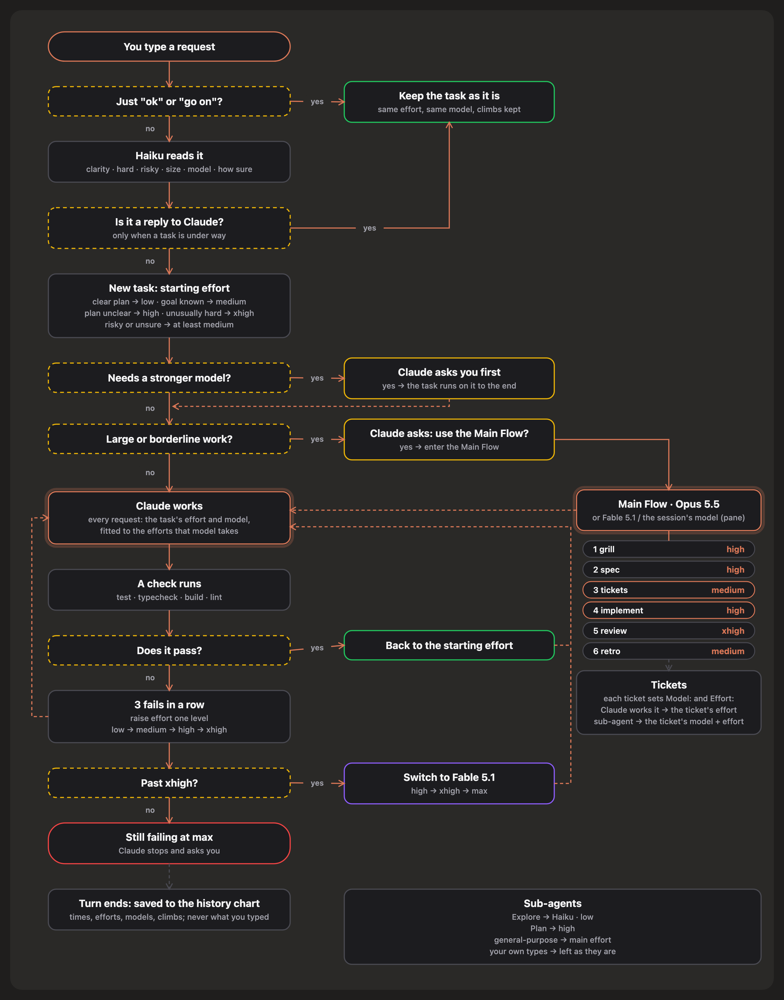
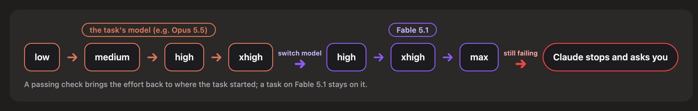
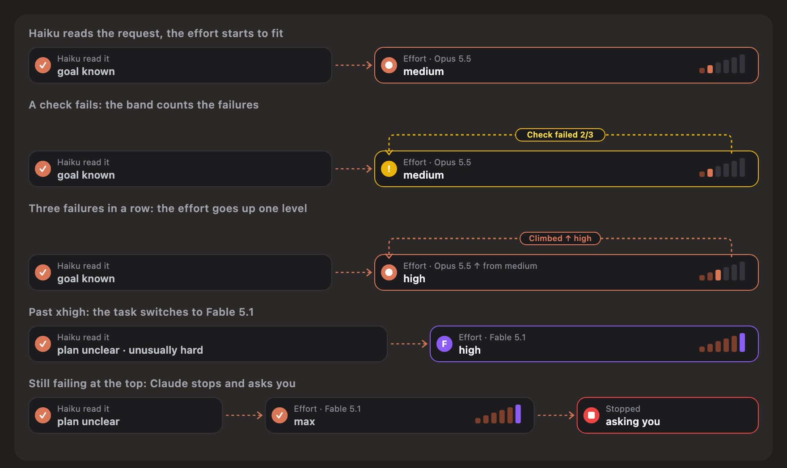
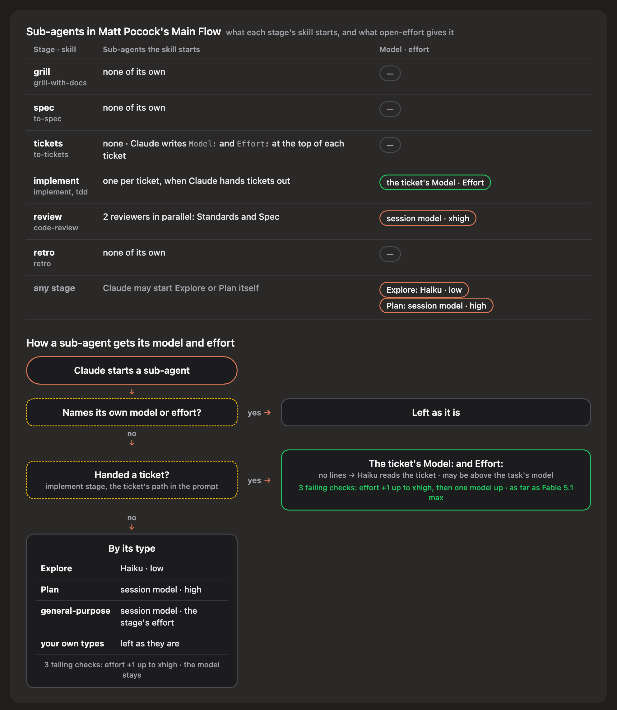

<p align="center">
  
</p>

<h1 align="center">open-effort</h1>

<p align="center">
  Claude thinks as hard as the work needs: no more, no less.<br>
  A Claude Code mod that fits effort to the work, and moves to a stronger model only when it has to.
</p>

<p align="center">
  <b>English</b> · <a href="README.th.md">ภาษาไทย</a>
</p>

<p align="center">
  
</p>

## What it does

- 🎯 **Fits the effort.** Haiku reads each new request: a clear plan starts at `low`, a hard one at `xhigh`.
- 📈 **Raises the effort when stuck.** Three failing checks in a row raise the effort one level. Past the highest level it switches to Fable 5.1, and if checks still fail, Claude stops and asks you what to do.
- 🧠 **Asks before switching models.** If the work needs a stronger model than the session's, Claude asks you first.
- 🗺️ **Runs Matt Pocock's Main Flow.** Grill to retro, every stage and every ticket at its own effort.
- 👀 **Shows what it uses, and why.** A band above the prompt shows the effort and model in use; a pane holds the switches, themes and history.

## Install

**Desktop app:** **+** next to the prompt → **Plugins** → **Add marketplace** → `JakkapatB/open-effort` → **Add plugin**.

**Terminal:**

```
/plugin install open-effort --marketplace JakkapatB/open-effort
```

Nothing to set up: the band appears as soon as it is installed.

## How it works

<p align="center">
  
</p>

### The ladder

<p align="center">
  
</p>

When a check passes, the effort goes back to the level the task started at.

<p align="center">
  
</p>

### Starting effort

| Haiku reads | Effort |
|---|---|
| You know what to do and how (a rename, a known pattern) | `low` |
| A known goal, the way needs thought | `medium` |
| The plan is not clear yet | `high` |
| Unusually hard (concurrency, migrations) | `xhigh` |
| Risky, or Haiku is unsure | at least `medium` |

The mod never picks `max` by itself.

### Matt Pocock's Main Flow

<p align="center">
  
</p>

| Stage | grill | spec | tickets | implement | review | retro |
|---|---|---|---|---|---|---|
| Effort | `high` | `high` | `medium` | `high` | `xhigh` | `medium` |

- The flow runs on **Opus 5.5** by default. Pick **Fable 5.1** or **the session's model** in the pane.
- Each ticket can set its own `Model:` and `Effort:`. A sub-agent given a ticket uses the model and effort the ticket sets.
- Needs [Matt Pocock's skills](https://github.com/mattpocock/skills). The pane says which are missing.

#### Sub-agents in the flow

<p align="center">
  
</p>

A sub-agent's effort follows the stage it runs in: the code-review reviewers run at `xhigh` because the review stage does. Apart from Explore, which always runs on Haiku, only a ticket can put a sub-agent on another model.

## The pane

Open it with `/open-effort` or the band's **≡**.

<p align="center">
  
</p>

- **On or off** for this project (`/open-effort on|off` does the same).
- **Main Flow** on or off, and its model.
- **Language:** auto, ไทย or English.
- **Theme:** Claude, Lime, Ocean or Rose.
- **History:** the last 500 turns of this project.

<p align="center">
  
</p>

<details>
<summary><b>More details</b></summary>

### One model per task

A task keeps one model from start to end, so the prompt cache holds. It changes only when you agree to a stronger model at the start, when it enters the Main Flow, or when the effort goes past `xhigh` and it switches to Fable 5.1. It never switches to a weaker model by itself.

### Models and effort

The current models take all five efforts. Opus and Sonnet 4.6 have no `xhigh`, Opus 4.5 stops at `high`, and Sonnet 4.5 and Haiku 4.5 take none. An effort a model does not take goes out as the nearest one below it.

### What counts as a check

Test, typecheck, build and lint runs (JavaScript/TypeScript, Python, Go, Rust, Node's test runner, make). A check counts only when its result is the command's result: not after `;` or `||`, not piped without `set -o pipefail`, not in the background.

### Data and privacy

- Everything stays in Claude Code's plugin store on your machine.
- The history never keeps what you typed: only times, efforts, readings, counts and model names.
- No network calls of its own. Its only model call is the Haiku reading of a new request (with the end of Claude's last message when a task is under way), or of a ticket without `Model:` and `Effort:` lines, sent through Claude Code.
- It reads only ticket files (`<feature>/issues/NN-*.md`) in the implement stage, and writes no files.
- It adds notes for Claude to the conversation, and registers three tools: `stage`, `model` and `report`.

### Limits

- The mod API is new in Claude Code and may change.
- Switching a task's model starts its prompt cache afresh.
- A slow Haiku reading arrives during the turn; the first requests use the session's own effort.
- The notes to Claude are instructions, not enforcement.

</details>

<details>
<summary><b>Development</b></summary>

```bash
claude plugin test .
claude plugin validate .
```

| Path | What it holds |
|---|---|
| `hooks/register.tsx` | wiring, the band and the pane |
| `hooks/policy.ts` | effort, the ladder, models, sub-agents, tickets |
| `hooks/score.ts` | the Haiku reading |
| `hooks/checks.ts` | which commands count as checks |
| `hooks/main-flow.ts` | Main Flow stages and notes |
| `hooks/history.ts` | history entries |
| `hooks/diagrams.ts` | the band, chart and themes as SVG |
| `hooks/words.ts` | English and Thai text |
| `tests/` | tests that drive the mod at its hooks |

Built and tested on Claude Code 2.1.308.

</details>

## Credits

The Main Flow and its skills are [Matt Pocock's](https://github.com/mattpocock/skills) (MIT). open-effort is not affiliated with Matt Pocock or Anthropic.

## License

[MIT](LICENSE)
