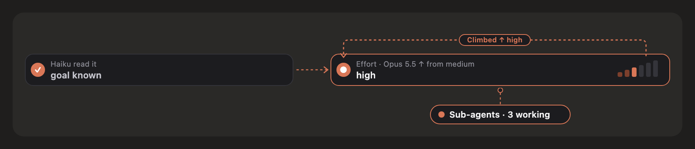
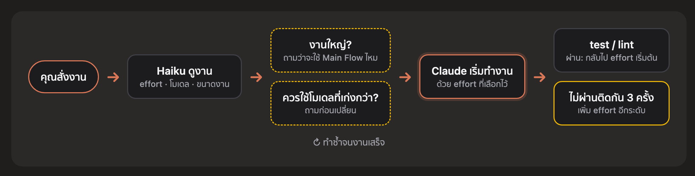
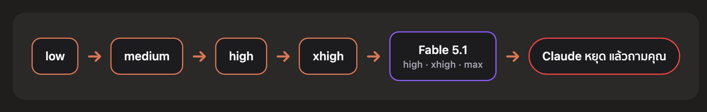
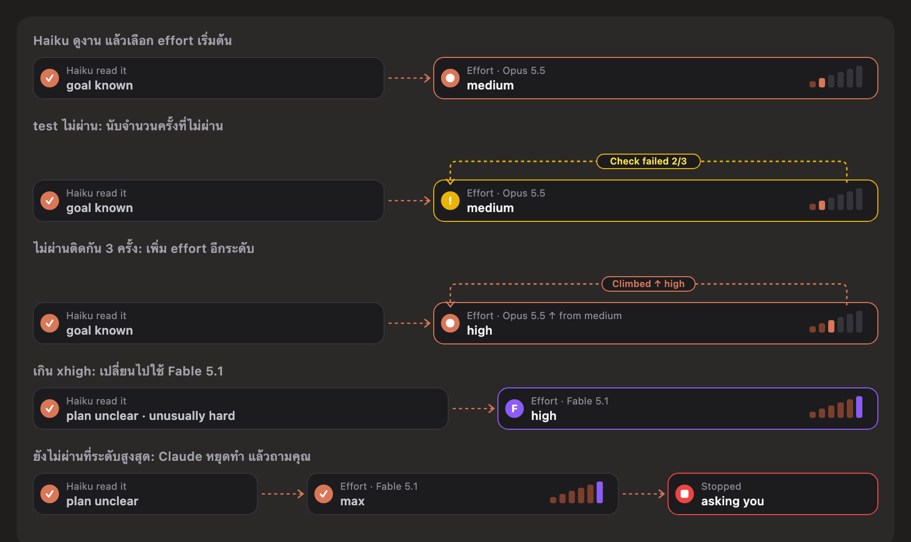
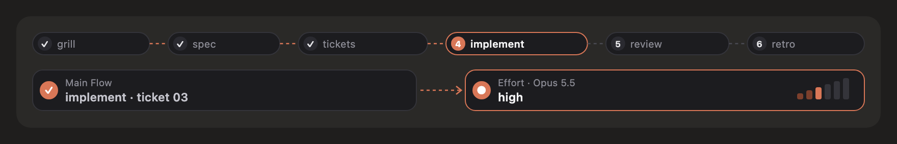
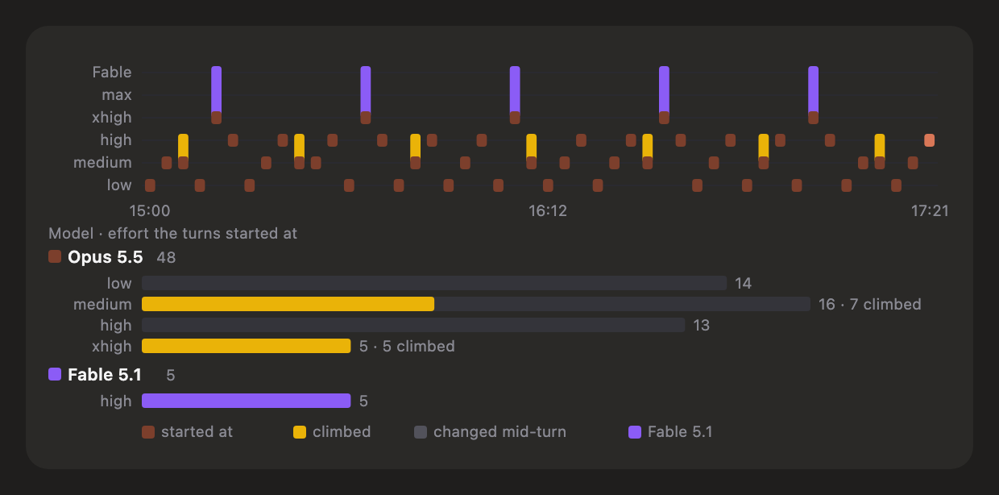
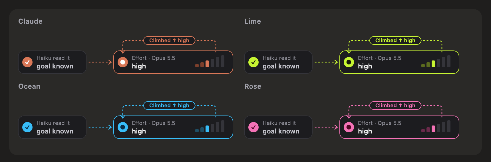

<p align="center">
  
</p>

<h1 align="center">open-effort</h1>

<p align="center">
  ให้ Claude ใช้ effort ให้เหมาะกับงาน ไม่ต้องคอยปรับเอง<br>
  mod สำหรับ Claude Code ที่เลือก effort ให้ตามงาน และเปลี่ยนไปใช้โมเดลที่เก่งกว่าเมื่อจำเป็นเท่านั้น
</p>

<p align="center">
  <a href="README.md">English</a> · <b>ภาษาไทย</b>
</p>

<p align="center">
  
</p>

## ฟีเจอร์

- 🎯 **เลือก effort ให้อัตโนมัติ:** Haiku จะดูงานที่คุณสั่งก่อน งานง่ายใช้ `low` งานยากใช้ `xhigh`
- 📈 **งานติดก็เพิ่ม effort ให้เอง:** ถ้า test หรือ lint ไม่ผ่านติดกัน 3 ครั้ง จะเพิ่ม effort ขึ้นทีละระดับ ถ้ายังไม่ผ่านจะเปลี่ยนไปใช้ Fable 5.1 และถ้ายังไม่ผ่านอีก Claude จะหยุดทำ แล้วถามคุณว่าจะเอายังไงต่อ
- 🧠 **ถามก่อนเปลี่ยนโมเดล:** ถ้างานควรใช้โมเดลที่เก่งกว่าที่ใช้อยู่ Claude จะถามคุณก่อนว่าจะเปลี่ยนไหม
- 🗺️ **รองรับ Main Flow ของ Matt Pocock:** ตั้งแต่ grill จนถึง retro แต่ละขั้นตอนและแต่ละ ticket ใช้ effort ที่ต่างกันได้
- 👀 **เห็นตลอดว่าใช้อะไรอยู่:** แถบเหนือช่องแชทบอกว่าตอนนี้ใช้ effort และโมเดลอะไร เพราะอะไร ส่วน pane ด้านข้างไว้เปิดปิด เปลี่ยนธีม และดูประวัติ

## ติดตั้ง

**แอป desktop:** กด **+** ข้างช่องแชท → **Plugins** → **Add marketplace** → ใส่ `JakkapatB/open-effort` → **Add plugin**

**terminal:**

```
/plugin install open-effort --marketplace JakkapatB/open-effort
```

ติดตั้งเสร็จใช้ได้เลย ไม่ต้องตั้งค่าเพิ่ม

## หลักการทำงาน

<p align="center">
  
</p>

### ลำดับการเพิ่ม effort

<p align="center">
  
</p>

พอ test ผ่าน effort จะกลับไปที่ระดับเริ่มต้นของงานนั้น

<p align="center">
  
</p>

### effort เริ่มต้น

| Haiku ประเมินว่า | effort |
|---|---|
| รู้ชัดว่าต้องทำอะไรและทำยังไง (เช่น เปลี่ยนชื่อ, ทำตามแบบที่มีอยู่แล้ว) | `low` |
| รู้เป้าหมาย แต่ต้องคิดวิธีทำ | `medium` |
| ยังไม่รู้ชัดว่าจะทำยังไง | `high` |
| ยากเป็นพิเศษ (เช่น concurrency, ย้ายข้อมูล) | `xhigh` |
| มีความเสี่ยง หรือ Haiku ไม่มั่นใจ | ไม่ต่ำกว่า `medium` |

mod จะไม่เลือก `max` ให้เอง

### Main Flow ของ Matt Pocock

<p align="center">
  
</p>

| ขั้นตอน | grill | spec | tickets | implement | review | retro |
|---|---|---|---|---|---|---|
| effort | `high` | `high` | `medium` | `high` | `xhigh` | `medium` |

- Main Flow ใช้ **Opus 5.5** เป็นค่าเริ่มต้น เปลี่ยนเป็น **Fable 5.1** หรือใช้ **โมเดลเดียวกับ session** ได้ใน pane
- แต่ละ ticket กำหนด `Model:` และ `Effort:` ของตัวเองได้ ถ้าส่ง ticket ให้ sub-agent ทำ sub-agent จะใช้โมเดลและ effort ตามที่ ticket ระบุ
- ต้องติดตั้ง [skill ของ Matt Pocock](https://github.com/mattpocock/skills) ก่อน ถ้ายังไม่ครบ pane จะบอกว่าขาดตัวไหน

## Pane

เปิดด้วยคำสั่ง `/open-effort` หรือกดปุ่ม **≡** บนแถบ

<p align="center">
  
</p>

- **เปิด/ปิด** สำหรับโปรเจกต์นี้ (หรือพิมพ์ `/open-effort on` / `off`)
- **Main Flow:** เปิด/ปิด และเลือกโมเดลที่จะใช้
- **ภาษา:** อัตโนมัติ, ไทย หรือ English
- **ธีมสี:** Claude, Lime, Ocean หรือ Rose
- **ประวัติ:** 500 turn ล่าสุดของโปรเจกต์

<p align="center">
  
</p>

<details>
<summary><b>รายละเอียดเพิ่มเติม</b></summary>

### งานหนึ่งใช้โมเดลเดียว

งานหนึ่งจะใช้โมเดลเดิมตั้งแต่ต้นจนจบ เพื่อไม่ให้ prompt cache หาย โมเดลจะเปลี่ยนแค่ 3 กรณี คือ คุณตกลงเปลี่ยนตอนเริ่มงาน, ตอนเริ่ม Main Flow และตอนที่ effort เกิน `xhigh` จนต้องเปลี่ยนไป Fable 5.1 และจะไม่เปลี่ยนไปใช้โมเดลที่ด้อยกว่าเอง

### โมเดลกับ effort

โมเดลรุ่นปัจจุบันรองรับ effort ครบทั้ง 5 ระดับ ส่วน Opus และ Sonnet 4.6 ไม่มี `xhigh`, Opus 4.5 สูงสุดแค่ `high` และ Sonnet 4.5 กับ Haiku 4.5 ไม่รองรับ effort เลย ถ้าโมเดลไม่รองรับระดับไหน จะใช้ระดับที่ต่ำกว่าถัดลงมาแทน

### คำสั่งแบบไหนที่นับ

นับ test, typecheck, build และ lint (JavaScript/TypeScript, Python, Go, Rust, test ของ Node และ make) โดยนับเฉพาะเมื่อคำสั่งนั้นเป็นตัวตัดสินว่าทั้งบรรทัดผ่านหรือไม่ผ่าน คืออยู่ท้ายสุด หรือต่อด้วย `&&` เท่านั้น ถ้ามี `;` หรือ `||` ต่อท้าย, ส่งต่อด้วย `|` โดยไม่ได้ตั้ง `set -o pipefail` หรือรันเป็น background จะไม่นับ

### sub-agent

| sub-agent | โมเดล · effort |
|---|---|
| Explore | Haiku · `low` |
| Plan | โมเดลเดียวกับ session · `high` |
| general-purpose | โมเดลเดียวกับ session · effort เท่ากับงานหลัก |
| แบบที่คุณสร้างเอง | ไม่ปรับให้ |

### ข้อมูลและความเป็นส่วนตัว

- ข้อมูลทั้งหมดเก็บไว้ในเครื่องคุณ ใน plugin store ของ Claude Code
- ประวัติไม่ได้เก็บข้อความที่คุณพิมพ์ เก็บแค่เวลา, effort, ผลประเมิน, จำนวนครั้ง และชื่อโมเดล
- mod ไม่ได้ส่งข้อมูลออกไปไหนเอง สิ่งเดียวที่ส่งคือให้ Haiku ประเมินงานใหม่ (ถ้ามีงานค้างอยู่ จะส่งข้อความล่าสุดของ Claude ไปบางส่วนด้วย) หรือประเมิน ticket ที่ไม่ได้ระบุ `Model:` และ `Effort:` ซึ่งส่งผ่าน Claude Code ตามปกติ
- อ่านไฟล์แค่ ticket (`<feature>/issues/NN-*.md`) ตอนอยู่ในขั้นตอน implement และไม่เขียนไฟล์ใดๆ
- จะเพิ่มข้อความแนะนำให้ Claude ในแชท และเพิ่ม tool 3 ตัว คือ `stage`, `model` และ `report`

### ข้อจำกัด

- API สำหรับ mod ของ Claude Code ยังใหม่อยู่ อาจมีการเปลี่ยนแปลง
- ถ้าเปลี่ยนโมเดลของงาน prompt cache ของงานนั้นจะต้องเริ่มใหม่
- ถ้า Haiku ตอบช้า request แรกๆ ของ turn นั้นจะใช้ effort ของ session ไปก่อน
- ข้อความที่ mod ส่งให้ Claude เป็นแค่คำแนะนำ Claude อาจไม่ทำตามทุกครั้ง

</details>

<details>
<summary><b>สำหรับนักพัฒนา</b></summary>

```bash
claude plugin test .
claude plugin validate .
```

โครงสร้างโค้ดดูได้ที่ [README ภาษาอังกฤษ](README.md) พัฒนาและทดสอบบน Claude Code 2.1.308

</details>

## เครดิต

Main Flow และ skill เป็นผลงานของ [Matt Pocock](https://github.com/mattpocock/skills) (MIT) โปรเจกต์นี้ไม่ได้เกี่ยวข้องกับ Matt Pocock หรือ Anthropic

## License

[MIT](LICENSE)
